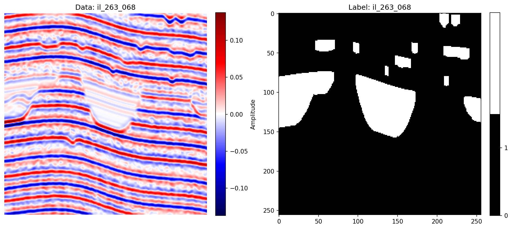
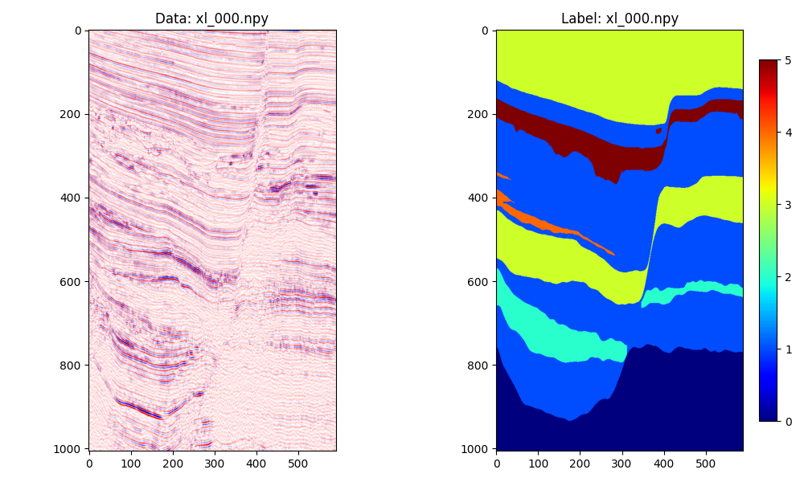
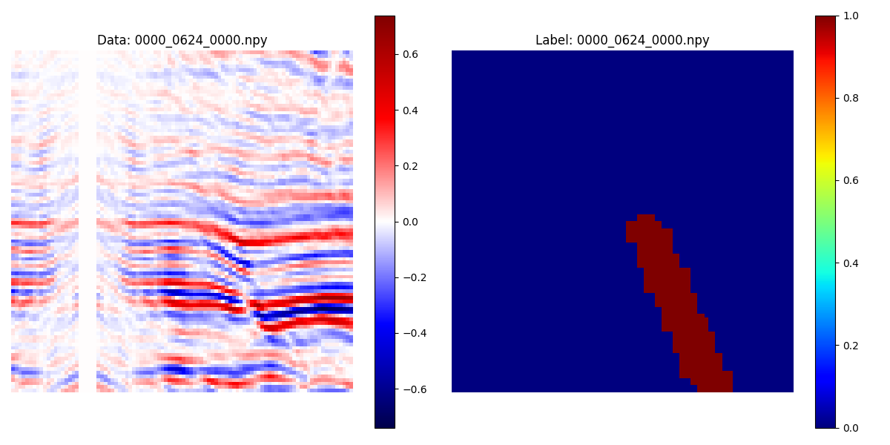
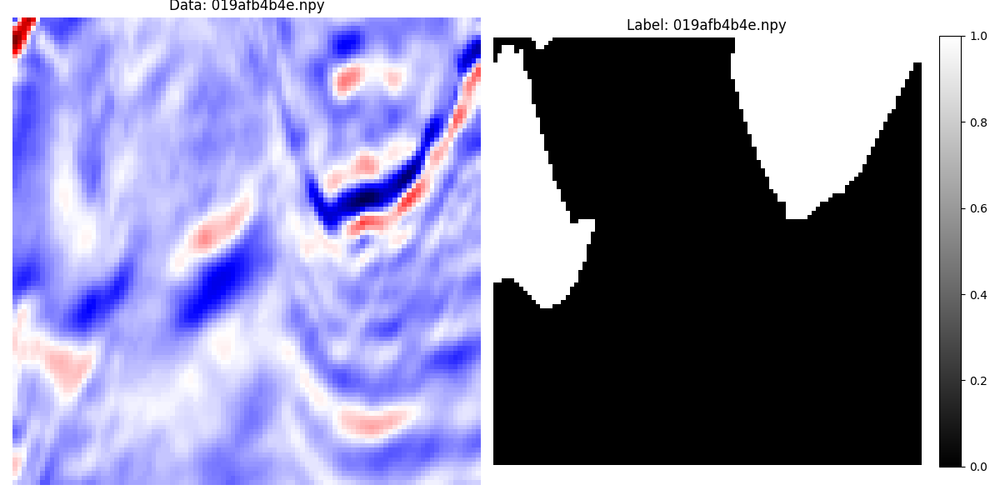
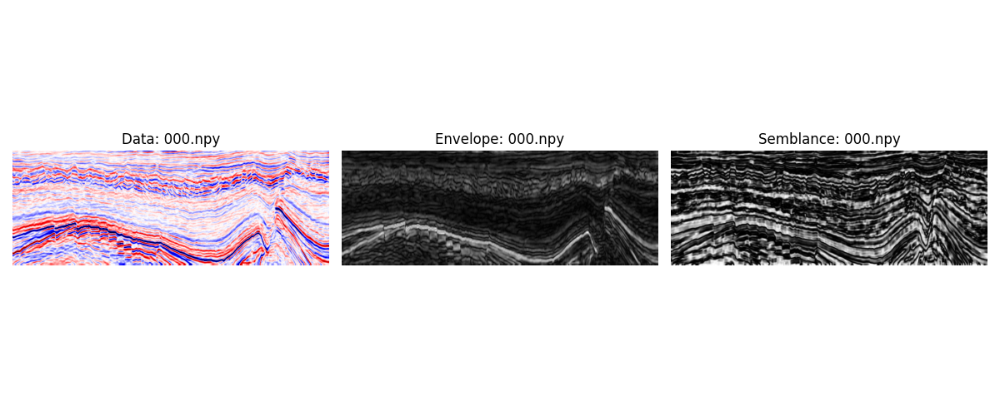
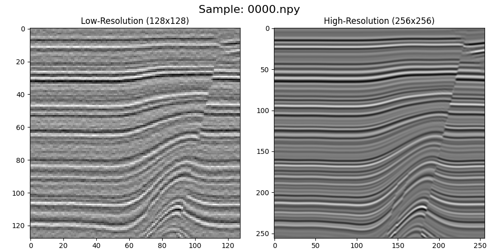

# Foundational Model Seismic Datasets

This repository contains a collection of scripts used to process and generate seismic datasets for various tasks such as classification and segmentation, used for training and evaluating foundational models in geophysics. The datasets are organized in a structured format, making it easy to load, preprocess, and utilize them for training machine learning models.


## Repository Structure

```text
seismic-datasets/
├── LICENSE
├── README.md
├── data
│   ├── original
│   │   ├── aicrowd_seamai
│   │   │   ├── data_train.npy
│   │   │   └── labels_train.npy
│   │   ├── cigChannel
│   │   │   ├── Assorted_Channel_Label_300-349
│   │   │   ├── Assorted_Channel_Label_350-399
│   │   │   ├── Assorted_Channel_Seismic_300-349
│   │   │   └── Assorted_Channel_Seismic_350-399
│   │   ├── F3
│   │   │   └── data
│   │   │       ├── test_once
│   │   │       └── train
│   │   ├── seismicSuperResolutionData
│   │   │   ├── nx2
│   │   │   └── sx
│   │   ├── tgs
│   │   │   └── train
│   │   └── thebe
│   │       ├── test
│   │       ├── train
│   │       └── val
│   └── processed
│       ├── channel_identification
│       │   └── cigChannel
│       ├── facies
│       │   └── aicrowd_seamai
│       ├── faults
│       │   └── thebe
│       ├── salt
│       │   └── tgs
│       ├── seismic_attribute_calculation
│       │   └── F3
│       └── super_resolution
│           └── seismic_super_resolution
├── requirements.txt
├── tasks
│   ├── channel_identification
│   │   └── cigChannel
│   │       ├── README.md
│   │       ├── create_dataset.py
│   │       ├── create_partition_random.sh
│   │       ├── examples
│   │       ├── figures
│   │       ├── plot_dataset.py
│   │       └── plot_some_samples.sh
│   ├── facies
│   │   └── aicrowd_seamai
│   │       ├── README.md
│   │       ├── create_dataset.py
│   │       ├── create_partition_test_first.sh
│   │       ├── examples
│   │       ├── figures
│   │       ├── plot_dataset.py
│   │       └── plot_some_samples.sh
│   ├── faults
│   │   └── thebe
│   │       ├── README.md
│   │       ├── create_dataset.py
│   │       ├── create_partition_predefined.sh
│   │       ├── plot_dataset.py
│   │       └── plot_some_samples.sh
│   ├── salt
│   │   └── tgs
│   │       ├── README.md
│   │       ├── create_dataset.py
│   │       ├── create_partition_random.sh
│   │       ├── examples
│   │       ├── figures
│   │       ├── plot_dataset.py
│   │       └── plot_some_samples.sh
│   ├── seismic_attribute_calculation
│   │   └── F3
│   │       ├── README.md
│   │       ├── create_dataset.py
│   │       ├── create_partition_test_predefined_val_last.sh
│   │       ├── examples
│   │       ├── figures
│   │       ├── plot_dataset.py
│   │       └── plot_some_samples.sh
│   └── super_resolution
│       └── seismic_super_resolution
│           ├── README.md
│           ├── create_dataset.py
│           ├── create_partition_random.sh
│           ├── examples
│           ├── figures
│           ├── plot_dataset.py
│           └── plot_some_samples.sh
└── utils
    ├── __init__.py
    └── data.py
```

- `data/original/`: This directory is intended to store the original raw data for each dataset. The original data is not included in this repository, but instructions for downloading and organizing it are provided in the `README.md` files within each dataset folder under `tasks/`.
- `tasks/`: This directory contains subdirectories for each task (e.g., `facies`, `faults`, and `salt`), and within each task, there are subdirectories for each dataset (e.g., `aicrowd_seamai`, `thebe`, and `tgs`). Each dataset folder contains scripts for processing the data, creating partitions, plotting samples, and example notebooks for training models.

### Conventions

- The samples are saved in `.npy` format for easy loading with NumPy.

Each dataset is organized under `tasks/<task_name>/<dataset_name>/`. The `data/tasks` directory contains subdirectories for each task (e.g., `facies`, `faults`, and `salt`). Each task directory contains subdirectories for each dataset related to that task (e.g., `aicrowd_seamai`, `thebe`, and `tgs`).
Inside each dataset directory, there are scripts and folders for processing the data, including:
- `README.md`: Instructions for downloading and processing the data.
- `create_dataset.py`: Script that processes raw data and generates the structured dataset.
- `create_partition_*.sh`: (optional) Shell scripts to create specific data partitions. This is usually a convenience script that calls `create_dataset.py` with appropriate arguments.
- `plot_dataset.py`: (optional) Script that plots selected processed samples from train/val/test splits.
- `plot_some_samples.sh`: (optional) Shell script to generate quick visual checks by calling `plot_dataset.py`.
- `figures/`: (optional) A folder containing visualizations related to the dataset partitioning or samples.

## Requirements

Please refer to the `README.md` file in each dataset folder for instructions on how to download the original data. The original data should be placed in the `data/original` at root level, following the structure specified in each dataset's `README.md` file.

The original data is not included in this repository, but is available in the following locations:

- Discovery cluster: `/home/shared/deeprock_datasets/`

Once you have the original data, you can run the processing scripts to generate the processed datasets. You can run the processing scripts on your local machine or on the Discovery cluster, using the provided Docker image for a consistent environment.

### Using VSCode Remote Containers

1. Clone this repository to your machine.
2. Open the repository folder in VSCode.
3. Edit `.devcontainer/devcontainer.json` in order to mount the folder where you have the original data (`mounts` key). For instance, the following line mounts the `deeprock_datasets` folder in the Discovery cluster to the container, allowing you to access the original data from within the container (at `data/`). Make sure to adjust the source path according to where you have the original data on your machine.

```json
"mounts": ["source=/home/shared/deeprock_datasets/,target=${containerWorkspaceFolder}/data/,type=bind,readonly"],
```

4. If you have the Remote - Containers extension installed, you should see a prompt to reopen the folder in a container. Click "Reopen in Container". This will build the Docker image defined in the `.devcontainer` folder and open a new VSCode window connected to the container.
5. In the terminal of the VSCode window connected to the container, you can navigate to the dataset folders and run the processing scripts as described in each dataset's `README.md` file. The processed data will be saved in the `processed_data/` folder within each dataset directory.
6. Examples for executing deep learning models are located under `examples/` folder inside each dataset directory, as notebooks. You can run these notebooks in the same container environment to train and evaluate models on the processed datasets.

>**NOTE**: The example notebooks are intended to be simple and easy to follow, showing that the datasets can be used to train models (as simple as it could be). They may not include advanced techniques or optimizations. Thus, use default settings for models, training, and evaluation as much as possible. Feel free to create more advanced notebooks in a separate repository if needed.

## Processing Steps

To process a dataset, follow these steps:
1. Navigate to the dataset directory. For example, for the TGS dataset:
   ```bash
   cd tasks/salt/tgs
   ```
2. Check `README.md` file for instructions of processing the data. This usually involves running the `create_dataset.py` script with appropriate arguments. For convenience, we also provide shell scripts that call `create_dataset.py` with the correct arguments for different partitioning methods. You can run the shell script directly to generate the processed data. For instance, for TGS dataset with random partitioning method:
   ```bash
   bash create_partition_random.sh
   ```
3. The processed data will be saved in the `processed_data/` folder within the dataset directory, organized by partitioning method (e.g., `partition_method_random/`) and by train/val/test splits.


## Tasks and Datasets

| Task | Dataset | Folder | Train Example | Sample Example |
|---|---|---|---|---|
| Channel Identification | CIG Channel | `tasks/channel_identification/cigChannel` | [train_deeplabv3.ipynb](tasks/channel_identification/cigChannel/examples/train_deeplabv3.ipynb) |  |
| Facies Segmentation | AIcrowd SEAM-AI | `tasks/facies/aicrowd_seamai` | [train_deeplabv3.ipynb](tasks/facies/aicrowd_seamai/examples/train_deeplabv3.ipynb) |  |
| Fault Segmentation | Thebe | `tasks/faults/thebe` | [train_deeplabv3.ipynb](tasks/faults/thebe/examples/train_deeplabv3.ipynb) |  |
| Salt Segmentation | TGS | `tasks/salt/tgs` | [train_deeplabv3.ipynb](tasks/salt/tgs/examples/train_deeplabv3.ipynb) |  |
| Seismic Attribute Calculation | F3 | `tasks/seismic_attribute_calculation/F3` | [train_deeplabv3.ipynb](tasks/seismic_attribute_calculation/F3/examples/train_deeplabv3.ipynb) |  |
| Super Resolution | TGS | `tasks/super_resolution/seismic_super_resolution` | [train_deeplabv3.ipynb](tasks/super_resolution/seismic_super_resolution/examples/train_deeplabv3.ipynb) |  |


### Facies Segmentation (Multi-class Segmentation)

This task focuses on multi-class semantic segmentation of seismic images, where each pixel is assigned a seismic facies label. Seismic facies segmentation requires modeling both fine-grained textural characteristics and large-scale stratigraphic context, as facies boundaries are often laterally continuous and extend over long spatial ranges within the seismic volume.

For this task, we use the AIcrowd SEAM-AI dataset [1], which comprises a three-dimensional seismic volume with corresponding facies annotations. Although the dataset provides one training volume and two test volumes, only the training volume contains labels and is therefore used in this work. To enable supervised learning and evaluation for downstream tasks, the labeled volume is deterministically partitioned along the crossline direction into three contiguous subsets, following the same partitioning strategy adopted by Tolstaya and Egorov [2].
The first block of crosslines (200 crosslines) is assigned to the test set, followed by a validation block of 51 crosslines, while the remaining crosslines are used for training.

Two-dimensional slices are extracted from the three-dimensional volume and stored as NumPy arrays. The training set includes both inline and crossline slices, whereas the validation and test sets contain only crossline slices in order to reduce spatial leakage between splits. No additional filtering, normalization, or data augmentation is applied during preprocessing.


### Fault Segmentation (Binary Segmentation)

This task addresses binary semantic segmentation of seismic data, with the objective of identifying fault structures within seismic images. Fault segmentation requires sensitivity to subtle reflector discontinuities and localized structural offsets, and is particularly challenging due to severe class imbalance and the often weak and discontinuous seismic signatures of faults.

For this task, we use the Thebe dataset [3], a publicly available benchmark specifically designed for seismic fault detection. The dataset consists of nine labeled seismic volumes for training, two for validation, and three for testing, following a predefined and fixed data split. Each volume is accompanied by a three-dimensional binary fault annotation.

We adopt a preprocessing pipeline similar to that of An et al. [4], in which the 3D seismic volumes are sliced along the first spatial direction to generate two-dimensional sections. From each section, patches of size $96 \times 96$ pixels are extracted using a stride of 48 pixels in both spatial dimensions. To mitigate class imbalance, we only keep patches containing at least 3% fault pixels, while patches dominated by background are discarded. 
No additional preprocessing is applied, and all extracted patches are stored as individual NumPy arrays within a standardized directory structure. 


### Salt Segmentation (Binary Segmentation)

This task consists of binary semantic segmentation of seismic images, where the objective is to assign each pixel to either a salt body or the surrounding sediment. It is a dense prediction problem that requires learning spatially coherent representations capable of capturing strong impedance contrasts, sharp boundaries, and complex salt geometries, which are known to distort seismic wave propagation.

The TGS Salt Identification Challenge dataset [5] is a widely used benchmark for salt body segmentation, originally released as part of a Kaggle competition. It consists of seismic images paired with binary masks that indicate the presence of salt bodies. The original dataset includes 4000 labeled training images and a separate set of unlabeled test images.

Since our benchmark focuses on supervised learning for downstream tasks, we utilize only the labeled portion of the dataset and construct our own training, validation, and test splits.
Specifically, the dataset comprises 4000 samples of size $101 \times 101$ pixels, which are randomly partitioned into training, validation, and test sets following an 70\%/10\%/20\% split, respectively. We adopted the random split since the dataset is not volumetric and does not contain spatially contiguous samples.
No additional preprocessing is performed, and both images and masks are stored in NumPy format for efficient data loading. 


### Seismic Attribute Calculation (Regression)

Seismic data contains valuable information about the Earth's subsurface and plays a central role in oil and gas (O&G) exploration. Seismic attributes are derived from this data to emphasize relevant structures and properties, thereby enhancing geological and geophysical interpretation. However, when computed over large datasets, common in the O&G industry, these attributes can be computationally expensive in terms of both processing power and memory usage.
This task focuses on seismic attribute calculation formulated as a regression problem, where the objective is to predict a seismic attribute directly from seismic data. Solving this problem requires learning complex relationships between the input data and the corresponding attributes, including both local and non-local patterns present in seismic images.

For this study, we use the F3 dataset [6], which consists of a three-dimensional seismic volume divided into training and test sets. Two seismic attributes, envelope and semblance, are computed from the seismic data following the approach of Hecker et al. [7]. The files `train/train_seismic.npy` and `test_once/test1_seismic.npy` are used as the training and test inputs, respectively. The file `test_once/test2_seismic.npy` is excluded because its shape differs from that of the training data, making it unsuitable for consistent model evaluation.

The training data is further split into training and validation subsets using a predefined scheme, where the last 10% of seismic sections are reserved for validation. The test set is provided as a separate file. Seismic attributes are computed for the entire training dataset (prior to the split) and for the test dataset, producing attribute volumes with the same dimensions as the original seismic data. Finally, the volumes are sliced along the first spatial dimension to generate two-dimensional sections of size (255 \times 701) pixels. These sections are stored as individual NumPy arrays in a standardized directory structure, without additional preprocessing.


### Seismic Super-Resolution (Regression)

Seismic interpretation is often limited by the quality of acquired data, which typically suffers from low spatial resolution and noise contamination due to acquisition and processing constraints. These limitations difficults the identification of fine geological structures such as thin layers and small-scale faults. Traditional approaches to improve resolution, such as high-density acquisition or broadband processing, are costly and computationally demanding. To address these challenges, recent work has proposed deep learning methods capable of performing seismic image super-resolution and denoising simultaneously [8]. In particular, convolutional neural networks (CNNs) can learn to reconstruct high-resolution, clean seismic images directly from low-resolution, noisy inputs, significantly enhancing structural details while preserving geological consistency .

The dataset used for this task follows the methodology proposed by Li et al. [8]. Synthetic datasets are generated to serve as ground truth. Specifically, three-dimensional seismic volumes are simulated by constructing realistic reflectivity models that include geological features such as folding and faulting. These models are convolved with high-frequency wavelets to produce high-resolution seismic volumes, from which two-dimensional slices are extracted as target images. Corresponding low-resolution inputs are created by applying low-frequency wavelets, adding random noise, and downsampling the resulting images. This process yields paired datasets of noisy low-resolution inputs and clean high-resolution targets, enabling supervised learning of the super-resolution mapping.

The dataset is composed of multiple independent 2D seismic images, allowing for a random partitioning strategy. Each sample consists of a low-resolution input of size ($128 \times 128$) pixels and a corresponding high-resolution target of size ($256 \times 256$), reflecting an upsampling factor of 2. The data is randomly split into training, validation, and test sets. This random partitioning is appropriate because the samples are extracted from different regions and volumes, reducing spatial correlation between subsets. After that, images are stored as individual NumPy arrays in a standardized directory structure, without additional preprocessing.


### Channel Identification (Binary Segmentation)

This task focuses on binary semantic segmentation of seismic data, where each pixel is assigned to either a channel or non-channel class. Channel identification requires capturing both local reflector textures and broader depositional geometry, because channels can be laterally continuous, branching, and morphologically complex across the seismic cube.

For this task, we use the CIG Channel dataset [9], which provides 100 3D seismic cubes and corresponding channel labels in `.dat` format. Each cube has dimensions of `(256, 256, 256)` and is labeled with multiple channel classes. However, for our benchmark, we remap all channel labels to a single binary class (channel vs non-channel) to focus on the core segmentation challenge. This dataset was sinthetically generated using a geological process-based model and is designed to mimic real-world channel features while providing clean ground truth labels.

We perform a random train/val/test split at the cube level, resulting in 70 cubes for training, 10 for validation, and 20 for testing. Each cube is then sliced into 2D images along the depth axis, yielding a large number of 2D samples for model training and evaluation. No additional preprocessing is applied, and both seismic data and labels are stored in NumPy format for efficient loading.

## References

```
[1] AICrowd SEAM AI. Seismic facies identification challenge, 2020.
[2] Ekaterina Tolstaya and Anton Egorov. Deep learning for automated seismic facies classification. Interpretation,
10(2):SC31–SC40, 2022.
[3] Yu An, Jiulin Guo, Qing Ye, Conrad Childs, John Walsh, and Ruihai Dong. A gigabyte interpreted seismic dataset
for automatic fault recognition. Data in Brief, 37:107219, 2021.
[4] Yu An, Jiulin Guo, Qing Ye, Conrad Childs, John Walsh, and Ruihai Dong. Deep convolutional neural network
for automatic fault recognition from 3d seismic datasets. Computers & Geosciences, 153:104776, 2021.
[5] TGS. Tgs salt identification challenge, segment salt deposits beneath the earth’s surface, 2021
[6] Alaudah, Y., Michałowicz, P., Alfarraj, M. and AlRegib, G., 2019. A machine-learning benchmark for facies classification. Interpretation, 7(3), pp.SE175-SE187.
[7] Hecker, N., Napoli, O.O., Astudillo, C.A., Navarro, J.P., Souza, A., Miranda, D., Villas, L.A. and Borin, E., 2023, October. Computing seismic attributes with deep-learning models. In 2023 International Symposium on Computer Architecture and High Performance Computing Workshops (SBAC-PADW) (pp. 31-35). IEEE.
[8] Li, J., Wu, X. and Hu, Z., 2021. Deep learning for simultaneous seismic image super-resolution and denoising. IEEE Transactions on Geoscience and Remote Sensing, 60, pp.1-11.
[9] Wang, G., Wu, X. and Zhang, W., 2025. cigChannel: a large-scale 3D seismic dataset with labeled paleochannels for advancing deep learning in seismic interpretation. Earth System Science Data, 17(7), pp.3447-3471.
```